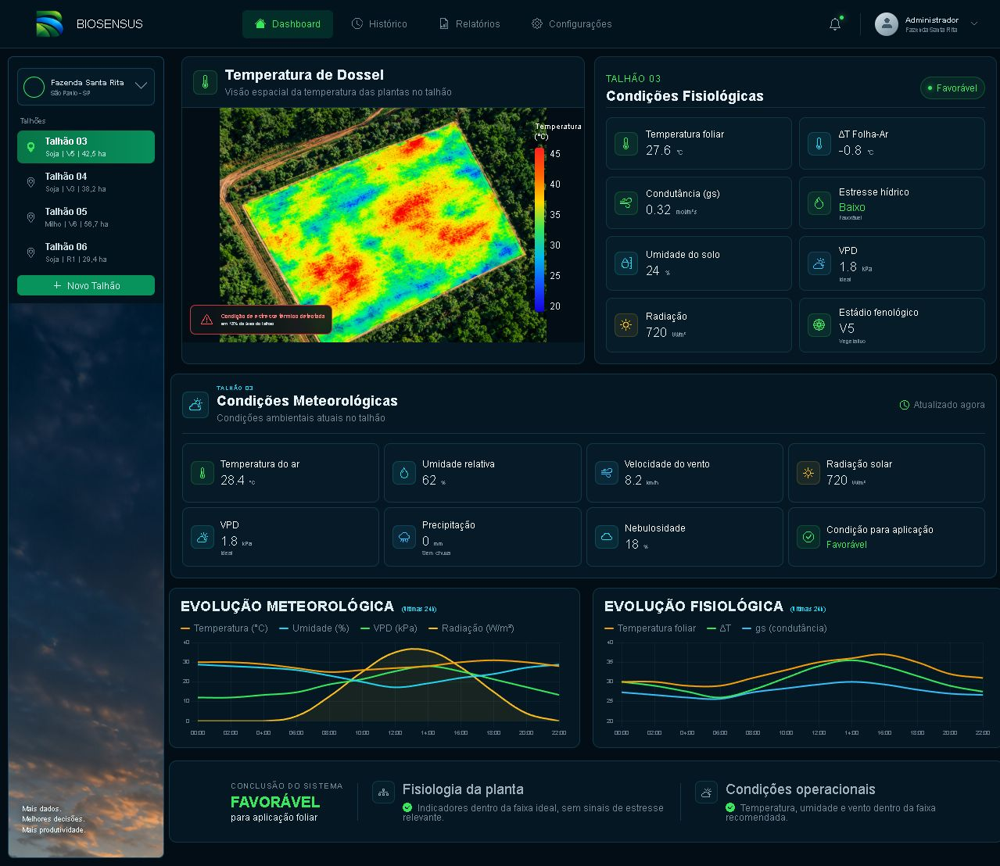
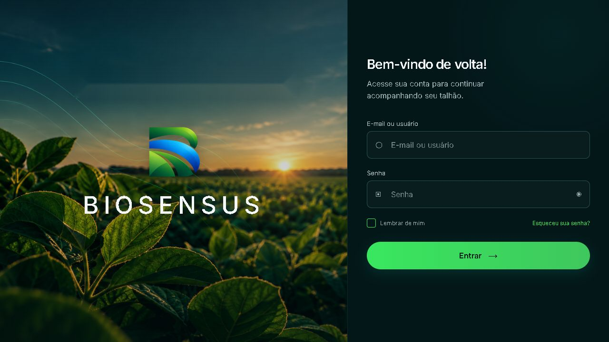

# BioSensus

**Connecting Weather, Plant Physiology and Smarter Agricultural Decisions.**


## Overview

BioSensus is an AgTech project focused on soybean crop monitoring and intelligent spraying window analysis through weather data and plant physiology. It aims to connect environmental conditions, crop physiological responses, and agricultural decisions in one digital environment.

Version 2.0 includes two independent frontend prototypes: a login interface and a crop dashboard.

## The Problem

Agricultural spraying decisions depend on several interacting factors, including weather, plant condition, and the surrounding environment. Reviewing these measurements separately can make it difficult to understand when conditions are suitable for a field operation.

## Our Approach

BioSensus proposes bringing weather and plant physiology information together to support the analysis of spraying windows. The prototype demonstrates the interface and information layout. The operational integrations and validated decision models remain future work.

## Current Development Status

**Frontend Prototype / Early Development — v2.0: BioSensus Frontend Prototype.**

Version 2.0 focuses on interface design. Dashboard values and chart series are hard-coded examples, and the login flow is a demonstration without authentication. No backend, live weather feed, sensor connection, operational AI, or validated agronomic recommendation engine is included.

## Current Features

| Classification | Available functionality |
| --- | --- |
| Implemented | HTML/CSS login and dashboard layouts with bundled PNG assets. |
| Implemented | Login password visibility toggle, required input fields, submission feedback, and password recovery placeholder message. |
| Implemented | Two Chart.js line charts driven by fixed arrays embedded in the dashboard HTML. |
| Prototype | Farm and field navigation, canopy temperature image, physiological indicators, weather cards, and a system conclusion panel. |
| Prototype | Login submission and recovery flow; no account verification, session creation, or dashboard redirect. |
| Planned | Live data ingestion, physiological monitoring, sensors, AI analysis, and validated spraying window recommendations. |

The “remember me” checkbox has visual state styling; persistence is not implemented. Several dashboard controls are presentation elements or `#` links. Labels such as “updated now” are part of the demonstration; values do not update from live sources.

### Interface Preview

Dashboard and login interfaces in version 2.0. Screenshots captured on October 27, 2026; displayed values are demonstration data.





## Future Capabilities

The following capabilities are **planned**, not operational in this version:

- Weather data integration.
- Plant physiological monitoring.
- IoT sensor connectivity.
- AI-assisted analysis.
- Spraying window recommendations.
- Historical agricultural data analysis.
- Decision-support dashboards connected to validated data sources.

## Technology Stack

- HTML5 and CSS, including media queries.
- Vanilla JavaScript for login interactions and inline dashboard chart configuration.
- Chart.js loaded from jsDelivr; the CDN URL does not pin a version.
- Bootstrap Icons 1.11.3 loaded from jsDelivr; used for interface icons.
- Google Fonts (Inter) imported by the login stylesheet.
- Bundled PNG images.
- A VS Code Live Server port setting in `Login_BIOSENSUS/.vscode/settings.json`.

The frontend runs as static files, without a package manager or build step. External fonts, icons, and charts require internet access.

## Project Structure

```text
.
├── README.md
├── CHANGELOG.md
├── CONTRIBUTING.md
├── .gitignore
├── .gitattributes
├── docs/
│   ├── project-overview.md
│   ├── roadmap.md
│   ├── versions.md
│   ├── known-limitations.md
│   ├── original-files.sha256
│   └── screenshots/
│       ├── dashboard.png
│       └── login.png
├── BIOSENSUS_Dashboard_principal/
│   ├── index.html
│   ├── style_page_1.css
│   ├── logo-biosenus.png
│   ├── sidebar-image.png
│   └── talhão-ideal.png
└── Login_BIOSENSUS/
    ├── .vscode/settings.json
    ├── index.html
    ├── script.js
    ├── style.css
    ├── biosensus-background.png
    └── logo-biosenus.png
```

The dashboard and login each have their own entry point and assets. Project documentation is in the repository root and `docs/`.

## Getting Started

1. Open the repository on GitHub. While it is private, sign in with an account that has access.
2. Select **Code → Download ZIP**, extract the download, and open the extracted repository folder.
3. Serve **each original interface folder as its own web root**. The HTML uses root-relative image paths such as `/logo-biosenus.png`, so serving the repository root or opening HTML directly may leave images unresolved.

If Python 3 is already available, open two terminals in the extracted repository folder and run:

```shell
python -m http.server 8000 --bind 127.0.0.1 --directory BIOSENSUS_Dashboard_principal
```

```shell
python -m http.server 8001 --bind 127.0.0.1 --directory Login_BIOSENSUS
```

Open [the dashboard](http://127.0.0.1:8000/) and [the login](http://127.0.0.1:8001/) in your browser. On Windows, `py` may replace `python` if that is the installed launcher. Python is an optional static preview tool, not an application dependency. Stop each server with Ctrl+C when finished.

Alternatively, use an existing static web server with each original folder configured as its root. If using VS Code Live Server, open the individual interface folder as the workspace; the login workspace setting specifies port 5502.

No installation, build, or code modification is required for a static preview. The login and dashboard are independent; submitting the login does not open the dashboard. Use dummy input when inspecting the demonstration.

See [known limitations](docs/known-limitations.md) for details about placeholder controls, external resources, and the original dashboard title.

## Development Roadmap

1. **Frontend Prototype** — initial interfaces are present; review and completion remain ongoing.
2. **Weather Data Integration** — connect and qualify weather data sources.
3. **Plant Physiology Data** — define and integrate physiological measurements.
4. **IoT and Real-Time Monitoring** — connect sensors and telemetry.
5. **AI-Assisted Decision Support** — develop and evaluate analytical models.
6. **Validation and Deployment** — test, validate, and deploy an appropriately supported platform.

See the [roadmap](docs/roadmap.md). Future phases are not marked complete and have no committed release dates.

## Project Vision

The long-term goal is a practical precision agriculture platform that transforms environmental and physiological data into clear, integrated information. BioSensus seeks to help soybean producers, agronomists, consultants, researchers, and agricultural technology teams better understand crop conditions and field operation timing.

## Contributing

Propose changes through issues and pull requests. Describe the problem, evidence, intended scope, and validation. Keep changes focused and include validation appropriate to their scope. See [CONTRIBUTING.md](CONTRIBUTING.md).

## License

A project license has not yet been selected. Obtain permission from the rights holder before reuse or redistribution. External libraries and assets may carry separate terms; their availability does not license the project as a whole.

## Disclaimer

BioSensus is under development. Displayed data, status labels, and conclusions are prototype examples and must not be used to direct agricultural operations. Any future analysis or recommendation requires appropriate testing and agronomic validation before practical use.

## Version History and Integrity

BioSensus 2.0 follows the original Pulse 1.0 dashboard. The project adopted the BioSensus name to distinguish it from LG's Pulse brand.

Browse [Pulse 1.0](https://github.com/matheuuniumar2/biosensus/tree/history/pulse-v1.0) for the historical dashboard or stay on `main` for the current project. The `v1.0` and `v2.0` tags identify the original version snapshots.

See [CHANGELOG.md](CHANGELOG.md), [version history](docs/versions.md), and the [SHA-256 manifest](docs/original-files.sha256) for release context and file integrity information.
